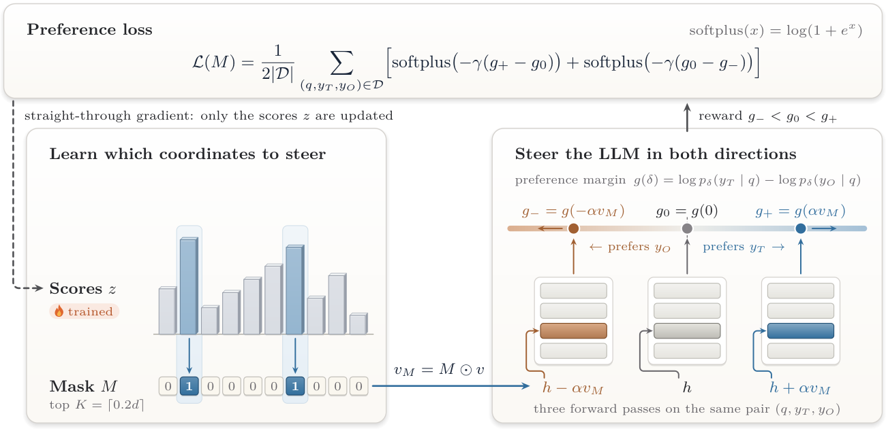
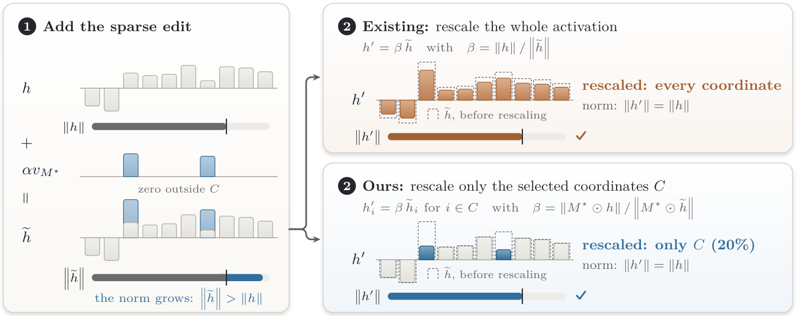
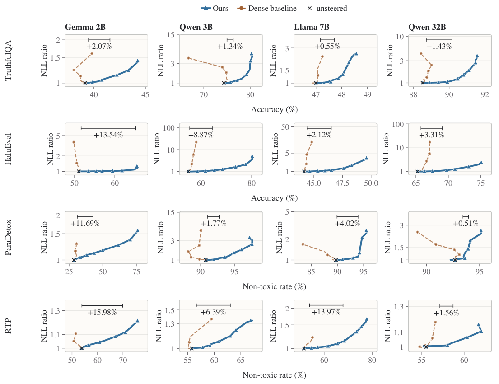

# Surpassing Dense Steering in LLMs through Optimized Sparsification and Constrained Normalization

Activation steering changes the behavior of a language model by adding a steering direction to an
intermediate activation at inference time. A stronger edit changes the behavior more, but it also
degrades the generated text. This repository contains the code and results of a sparse steering
method that reaches higher steering scores than dense steering under the same text-quality limits.
The method has two components:

1. **Optimized sparsification** learns which coordinates of a steering direction to modify.
2. **Constrained normalization** restores the activation norm by rescaling only those coordinates.

## Method

Let `h` be the `d`-dimensional residual-stream activation at the steered layer. The steering
direction `v` is the mean difference between the activations of preferred and opposite outputs over
contrastive training pairs. Dense steering (CAA) adds `α·v` to `h`, where `α` is the steering
strength, and therefore changes every coordinate.

### 1. Optimized sparsification



Existing sparse methods select coordinates with a fixed rule, such as the largest coefficients of
`v` or the highest attribution scores, which evaluates each coordinate individually. Optimized
sparsification learns a binary mask `M` that keeps `K = ⌈0.2d⌉` coordinates, and steers with the
masked direction `v_M = M ⊙ v`.

- **Trainable scores.** Each coordinate `i` has a score `z_i`. The mask keeps the `K` coordinates
  with the highest scores. Only the scores are trained; the language model and `v` stay frozen.
- **Loss.** For a training pair with prompt `q`, preferred output `y_T` and opposite output `y_O`,
  the preference margin under an edit `δ` is `g(δ) = log p_δ(y_T | q) − log p_δ(y_O | q)`. The
  loss, written at the top of the figure, compares the margin after steering along the masked
  direction, `g(α·v_M)`, and against it, `g(−α·v_M)`, with the unsteered margin `g(0)`. It rewards
  a mask for which `g(−α·v_M) < g(0) < g(α·v_M)`.
- **Straight-through gradient.** The forward pass always applies a binary mask with exactly `K`
  coordinates. The backward pass sends gradients to the scores through a sigmoid surrogate.
- **Joint selection.** All scores are trained through the behavior of the whole masked direction,
  so the mask selects a combination of coordinates. The selected coordinates differ substantially
  from those chosen by existing selection rules.
- **Fixed direction.** The method selects coordinates of an existing direction and does not learn a
  new one. It trains `d` scores, and it applies to directions built by other methods.

Implementation: `sparse_steering/method/mask_training/`.

### 2. Constrained normalization



A sparse edit still changes the norm of the activation, which degrades the generated text. Existing
norm-preserving methods rescale the whole activation. This changes every coordinate and removes the
sparsity of the edit. Constrained normalization rescales only the selected coordinates `C`, in two
steps:

1. **Add the masked direction:** `h̃ = h + α·v_M`. This changes only the coordinates in `C`.
2. **Rescale the selected coordinates:** `h′ᵢ = β·h̃ᵢ` for `i` in `C`, with
   `β = ‖M ⊙ h‖ / ‖M ⊙ h̃‖`. Every other coordinate keeps its value, `h′ᵢ = hᵢ`.

The steered activation has the original norm, `‖h′‖ = ‖h‖`, and 80% of its coordinates are exactly
those of `h`. This keeps the NLL of the generated text lower than rescaling the whole activation,
so a stronger edit fits within the text-quality limits.

Implementation: `sparse_steering/method/sparse_edit.py` and
`sparse_steering/method/constrained_normalization.py`.

### Result



Each curve sweeps the steering strength. The x-axis is the task score and the y-axis is the NLL
ratio between steered and unsteered text, where lower means less degraded text. The NLL ratio of
dense steering rises sharply while its score barely changes, whereas that of our method stays low
as its score rises. In the main comparison (Gemma 2B, Qwen 3B, Llama 7B and Qwen 7B on TruthfulQA,
HaluEval, ParaDetox and RealToxicityPrompts), our method attains the highest score among eight
methods in all 16 cases under the same text-quality limits, and it exceeds the dense baseline by
5.94% on average.

## Run

```bash
bash run_experiment.sh gemma truthfulqa 0
```

The arguments are the model (`gemma`, `qwen`, `llama`, `qwen7`, `qwen32b`), the task (`truthfulqa`,
`halueval`, `paradetox`, `rtp`) and the seed (`0` to `3`). The script creates the Python
environment, downloads the model and the data, trains the mask, evaluates every method over the
steering strengths and prints each method's best score within the text-quality limits. It requires
a CUDA GPU with bf16 support; `bash run_experiment.sh` lists its settings.

The individual commands are described in [reproduce/README.md](reproduce/README.md), the bundled
results of the paper in [results/README.md](results/README.md), and the experimental protocol in
[protocol/PROTOCOL.md](protocol/PROTOCOL.md).
